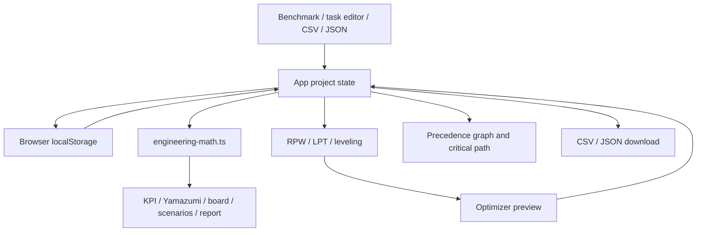

# LEANZR FlowLab master codebase audit

Audit date: 2026-10-17. Source baseline: `fe7f9fa7b2d059f1f34c30bfd887dd638de2ae70` (`main`). This is a documentation-only assessment; it changes no application code, tests, dependencies, or environment configuration.

## Scope and document map

The earlier “Master Codebase Audit” brief was not available in the current conversation or checkout. The user was asked to supply it while inspection continued. The six document names and severity convention below are inferred deliverables, not a claim that the missing brief was recovered. Reconcile any additional criteria against that brief before considering its exact acceptance requirements met.

| Document | Purpose |
| --- | --- |
| [Master codebase audit](MASTER_CODEBASE_AUDIT.md) | Architecture, capabilities, severity definitions, consolidated findings |
| [Engineering logic audit](ENGINEERING_LOGIC_AUDIT.md) | Units, formulas, resource assumptions, numerical counterexamples |
| [Optimizer and precedence audit](OPTIMIZER_PRECEDENCE_AUDIT.md) | Graph safety, heuristic correctness, result integrity |
| [Data and workflow audit](DATA_WORKFLOW_AUDIT.md) | Imports, persistence, identity, editing, security boundaries |
| [Validation and test strategy](VALIDATION_TEST_STRATEGY.md) | Executed checks, reproducible browser cases, missing regression coverage |
| [Implementation roadmap](IMPLEMENTATION_ROADMAP.md) | First phase, sequencing, dependencies, acceptance gates |

Inspected scope: all 22 files under `src` (5,441 lines), including 11 components and two test files; package manifest, TypeScript/Vite configuration, HTML entrypoint, ignore rules, and environment example. There is no repository README, AGENTS.md, CI workflow, or dependency lockfile in this baseline. No production dataset, plant time study, deployed service, or real equipment was inspected. Sample data is illustrative; its claimed industrial realism is not independent validation.

## Overall assessment

This is a coherent browser-based prototype with a reusable calculation module, deterministic RPW/LPT heuristics, interactive line allocation, scenarios, and exports. Its baseline type check, production build, and eight existing tests pass. These checks cover ordinary arithmetic and small acyclic examples; they do not establish trustworthy engineering output for invalid graphs, multiple operators, imported data, or multi-day plans.

The code is suitable for further development and demonstrations with reviewed inputs. Production planning approval should wait for the engineering release gates below. No evidence establishes an active production outage, exploited security incident, or actual plant harm.

## Architecture and implemented capabilities

| Layer | Current implementation | Consequence |
| --- | --- | --- |
| Application state | [App.tsx](../../src/App.tsx), one active `FlowProject` with embedded scenarios | Project changes flow through callbacks; imports and optimizer output can replace the model directly |
| Domain types | [flowlab.ts](../../src/types/flowlab.ts), compile-time interfaces | No runtime schema, schema version, complete graph-validity validator, or explicit resource scheduling model |
| Engineering calculations | [engineering-math.ts](../../src/utils/engineering-math.ts), pure calculations | Most views share metrics, but validity is not a first-class result |
| Optimization | [line-balancing-optimizer.ts](../../src/utils/line-balancing-optimizer.ts) | Three heuristics; duplicated metric logic and inconsistent operator assumptions |
| Persistence | [storage.ts](../../src/utils/storage.ts), localStorage | Single active-project key; no integrated multi-project save/recovery flow |
| Presentation | KPI strip, allocation board, stacked chart, graph, scenario comparison, printable report | Broad prototype coverage; no validated approval state |
| Runtime | React 19, TypeScript, Vite 8, Tailwind 4 | Client-only application; Express/dotenv/GenAI dependencies are not used by current source |

Implemented: benchmark switching; task CRUD and predecessor selection; station add/delete/rename/operator changes; task drag and quick moves; operating parameter editing; RPW/LPT previews; leveling preview; scenario snapshot/activation/deletion; JSON backup/restore; CSV task import/export; printable routing report; static Kaizen guidance.

Not implemented: finite-input/runtime schema validation; graph validity gate; machine/fixture or operator schedule feasibility; skill/ergonomic constraint enforcement; validated approvals; durable project history; server storage or collaboration; automated CI/browser regression suite. These are observed capability boundaries, not evidence that every feature is required for the product.

## Severity convention

- **P0 — engineering release blocker:** a reachable path defeats core validity or application integrity and must be fixed before claiming validated engineering decisions. This audit-specific priority does not mean an active incident or imminent physical danger.
- **P1 — high:** confirmed numerical, optimizer, persistence, or workflow defect with material decision/data consequences.
- **P2 — medium:** model/label ambiguity, scoped security exposure, usability gap, or development quality gap requiring planned remediation.

Confidence distinguishes executable reproductions, browser observations, source inspection, and unvalidated modeling assumptions. No numeric risk scores or invented compliance certifications are assigned.

## Consolidated findings

| ID | Priority | Finding | Evidence and detail |
| --- | --- | --- | --- |
| P0-001 | P0 | A normal predecessor edit creates a cycle and blanks the entire dashboard, even with the optimizer closed | Browser reproduction; [optimizer audit](OPTIMIZER_PRECEDENCE_AUDIT.md) |
| P0-002 | P0 | Invalid routing can be “attained”; report unconditionally says “Certified” | Numerical and rendered-report reproduction; [engineering audit](ENGINEERING_LOGIC_AUDIT.md) |
| ENG-001 | P1 | Period time/output is presented as daily time/output | Five-day numerical counterexample; [engineering audit](ENGINEERING_LOGIC_AUDIT.md) |
| ENG-002 | P1 | Backlog disappears from purported total work and VA ratio | Assigned10s VA + backlog90s NVA; [engineering audit](ENGINEERING_LOGIC_AUDIT.md) |
| ENG-003 | P1 | Operator count divides machine time without resource/concurrency justification | Existing automated laser benchmark and fixed-machine counterexample; [engineering audit](ENGINEERING_LOGIC_AUDIT.md) |
| ENG-004 | P2 | Labor-content lower bound is labeled minimum physical workstations | Multi-operator model conflict; [engineering audit](ENGINEERING_LOGIC_AUDIT.md) |
| ENG-005 | P2 | OEE field has no effect and capacity basis is not explicit | Source and parameter comparison; [engineering audit](ENGINEERING_LOGIC_AUDIT.md) |
| OPT-001 | P1 | Leveling reports improvements but returns unchanged assignments | Result versus canonical recomputation; [optimizer audit](OPTIMIZER_PRECEDENCE_AUDIT.md) |
| OPT-002 | P1 | Generated station IDs can collide and double-count work | Unique input station `station-2` becomes duplicate output IDs; [optimizer audit](OPTIMIZER_PRECEDENCE_AUDIT.md) |
| OPT-003 | P1 | RPW/LPT packing and summary disagree with multi-operator metrics | Two60s tasks, target60s, existing two-operator station; [optimizer audit](OPTIMIZER_PRECEDENCE_AUDIT.md) |
| OPT-004 | P1 | Oversize or incomplete optimization can be applied without a feasibility gate | Target60s, indivisible120s task; [optimizer audit](OPTIMIZER_PRECEDENCE_AUDIT.md) |
| DATA-001 | P1 | JSON restore/storage load accepts malformed project structures | Arrays-only import can crash calculation; [data audit](DATA_WORKFLOW_AUDIT.md) |
| DATA-002 | P1 | Partially invalid CSV replaces the full active task list with accepted rows | Existing14 tasks becomes1; [data audit](DATA_WORKFLOW_AUDIT.md) |
| DATA-003 | P1 | CSV drops unknown prerequisites and accepts ambiguous operation identities | Graph changes without an error; [data audit](DATA_WORKFLOW_AUDIT.md) |
| DATA-004 | P1 | CSV cannot round-trip multiline descriptions and accepts Infinity | Actual parser/exporter reproduction; [data audit](DATA_WORKFLOW_AUDIT.md) |
| DATA-005 | P1 | Editing a task deletes its required qualifications | Required skills omitted during object reconstruction; [data audit](DATA_WORKFLOW_AUDIT.md) |
| DATA-006 | P1 | Preset switching overwrites local work; save failures have no visible status | Single active-key workflow and swallowed storage errors; [data audit](DATA_WORKFLOW_AUDIT.md) |
| DATA-007 | P1 | Adding after station deletion duplicates station codes and redirects CSV assignments | Delete ST-02 then add creates second ST-05; [data audit](DATA_WORKFLOW_AUDIT.md) |
| UI-001 | P1 | Operating-parameter editor retains a previous project's values | Mount-only local form state; [validation strategy](VALIDATION_TEST_STRATEGY.md) |
| SEC-001 | P2 | Spreadsheet exports preserve formula-leading values | `=1+1` remains executable spreadsheet syntax; [data audit](DATA_WORKFLOW_AUDIT.md) |
| UI-002 | P2 | Main navigation disappears below the medium breakpoint without an alternative | [TopNav.tsx](../../src/components/TopNav.tsx), line119; [validation strategy](VALIDATION_TEST_STRATEGY.md) |
| UI-003 | P1 | Yamazumi bars use shifted baselines and shrink, producing false takt crossings | Measured browser geometry on the default benchmark; [validation strategy](VALIDATION_TEST_STRATEGY.md) |
| UI-004 | P1 | Keyboard focus escapes an open modal and can delete a background task | Isolated browser reproduction, task count12→11 with modal open; [validation strategy](VALIDATION_TEST_STRATEGY.md) |
| QA-001 | P2 | Tests omit known failure classes and no CI enforces them | Two test files, eight cases; [validation strategy](VALIDATION_TEST_STRATEGY.md) |

## Maintainability and delivery observations

`App.tsx` combines import parsing decisions, persistence, project management, and mutation handlers. A domain command layer could enforce invariants once before these actions reach views. Do not begin with a wholesale UI rewrite: introduce validated operations around the existing architecture and keep components thin.

RPW and LPT duplicate packing/result generation; graph traversal is separately implemented by the optimizer and graph view; the optimizer duplicates calculation logic. Consolidate graph validation and result evaluation before adding algorithms. Preserve heuristic selection as a strategy difference and use deterministic tie-breaking. A heuristic must report feasibility and objective value without claiming a global optimum.

The baseline has no lockfile or test script/CI workflow. The published environment already supplies dependencies; this audit did not reinstall them or change its configuration. The known Vite/esbuild peer-range conflict and lack of locked resolution belong in a later dependency-maintenance change. Vite's current `__dirname` compatibility warning does not fail this build.

Accessibility review found numerous unlabeled icon controls, labels without programmatic input associations, custom non-keyboard chart interactions, and modal markup without a full dialog/focus-management contract. Keyboard deletion behind an open modal and inaccessible narrow-viewport navigation were browser-confirmed; remaining observations are source-level, not a formal accessibility conformance assessment. Include focus isolation in the data-preservation gate and broader keyboard/narrow-viewport checks in the UI phase.

Security scope: current source has no application server, API authentication, or collaboration endpoint to assess. React text rendering provides ordinary escaping; no `dangerouslySetInnerHTML` use was found. JSON/CSV trust boundaries and browser-stored data are the immediate concerns. No dependency advisory scan, penetration test, tenant isolation assessment, or live secret validation was performed; absence of those checks is not a clean security bill.

## Recommended decision

Prioritize **Phase 1: engineering validity and data preservation** from the [roadmap](IMPLEMENTATION_ROADMAP.md). Add shared input/graph validation, explicit invalid/incomplete/infeasible states, honest report status, correct day/period and allocated/total metrics, safe imports, and regression fixtures. Restrict unsupported machine-capacity claims while resource semantics are defined. Then repair and verify optimizers against that same contract. Keep this audit pull request documentation-only; implementation should be reviewed separately.
